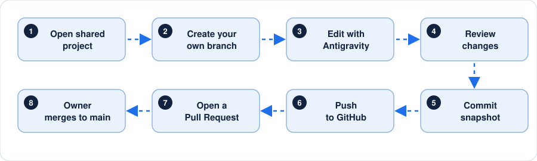
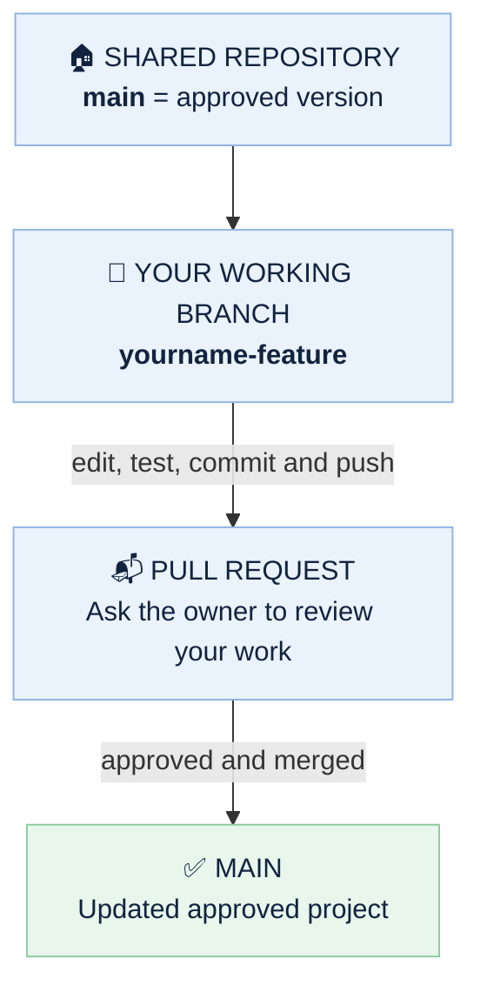

<div align="center">


<br>


**How beginners can edit, commit and push code to one shared GitHub repository using Google Antigravity.**

</div>

---

## ⚡ The Simple Workflow

<div align="center">
  
</div>

> [!NOTE]
> Made for team members who are new to GitHub. The steps below use Antigravity's **Agent chat** to help with Git, but **you must review and approve important actions.**

---

## 📑 Table of Contents

| # | Section | # | Section |
|:-:|---------|:-:|---------|
| 1 | [One-time setup](#1--one-time-setup) | 6 | [Daily routine](#6--daily-routine-start-and-finish-safely) |
| 2 | [Create your own branch](#2--before-editing-create-your-own-branch) | 7 | [Common problems](#7--common-problems-and-what-to-ask) |
| 3 | [Make code changes](#3--ask-antigravity-to-make-code-changes) | 8 | [Team rules](#8--team-rules) |
| 4 | [Save and push your work](#4--save-your-work-and-push-it-to-github) | 9 | [Project owner's checklist](#9--project-owners-checklist) |
| 5 | [Create a Pull Request](#5--create-a-pull-request-on-github) | 10 | [Quick glossary](#10--quick-glossary) |

---

## 1 · One-time setup

**What each team member needs:** a computer, Google Antigravity installed, a GitHub account, and an accepted collaborator invitation to the project repository.

### A. Accept the GitHub invitation

- [ ] Sign in to the GitHub account you will use for the project.
- [ ] Open the invitation email or GitHub notifications and accept the repository invitation.
- [ ] Open the repository link from the project owner. You should be able to see the files.

### B. Install and open Antigravity

- [ ] Download Antigravity from [antigravity.google/download](https://antigravity.google/download) and install it for your operating system.
- [ ] Launch Antigravity and sign in with your Google account when prompted.
- [ ] Create/open a Project and add the local folder that contains the Git repository.

### C. Get the shared repository onto your computer (clone)

1. On GitHub, open the team's repository and click the green **Code** button.
2. Copy the **HTTPS** repository URL. It usually ends in `.git`.
3. In Antigravity, open the **Agent chat** and paste the prompt below. Replace the placeholder with the URL.

```text
I am new to GitHub. Please help me clone this exact shared repository to my computer and
open its folder in Antigravity. Repository URL: PASTE_HTTPS_URL_HERE. Do not create a new
repository. Explain any sign-in prompt.
```

> [!TIP]
> If Git is not installed or Antigravity cannot find it, ask the agent to explain how to install Git for your operating system.

> [!CAUTION]
> **Do not paste passwords or access tokens into the chat.**

### D. Check the repository connection

```text
Please check this folder's Git remote and tell me the repository URL and current branch. Do
not change anything yet.
```

The remote should point to the **original team repository** (not a personal fork or a newly created repository).

---

## 2 · Before editing: create your own branch

A **branch** is your own safe work area. Everyone works in a separate branch, while the `main` branch holds the approved project. You do not need to understand the commands. Ask Antigravity to do the setup and explain the result.



### Ask Antigravity to create your branch

```text
Before I edit anything, check that this folder is connected to the original shared
repository. Fetch the latest information from GitHub. Create a new branch named
YOURNAME-short-task (for example, alex-login-page). Do not make changes on main. Tell me
which branch is active.
```

Use a short, clear branch name, such as `riya-homepage`, `sam-login-fix`, or `alex-dashboard`.

> [!IMPORTANT]
> Do not share one branch between several people. **Each person should have their own branch.**

---

## 3 · Ask Antigravity to make code changes

Describe the task clearly. Mention which feature to change, what the expected result is, and what must not be broken.

```text
Please work on [describe your feature]. First inspect the existing project and explain
which files you plan to change. Keep unrelated features unchanged. After editing, run the
appropriate checks and show me a summary of the files changed.
```

- [ ] Review the proposed plan and file changes.
- [ ] Test the feature in the project.
- [ ] If something breaks, ask Antigravity to **diagnose it before** asking it to make more changes.

---

## 4 · Save your work and push it to GitHub

This is the key part.

| Term | What it does |
|------|--------------|
| **Commit** | Saves a snapshot in Git **on your computer**. |
| **Push** | Uploads your branch to GitHub so the team can see it. |

### A. Ask Antigravity to review before uploading

```text
I have finished this task. Before uploading anything, show me: (1) my current branch, (2)
the changed files, (3) a summary of the changes, and (4) any test results. Check that I am
not on main. Do not push yet.
```

Read the summary. Make sure it contains only the work you intended to contribute.

### B. Ask Antigravity to commit and push

```text
Please commit and push my finished work to the original shared GitHub repository. First
confirm that I am on my own branch, not main. Include only the files related to my task.
Use this commit message: "Describe your change". If there are uncommitted changes from
someone else, stop and ask me. Do not force-push, do not delete files, and do not overwrite
remote work. Ask for confirmation before the push.
```

### C. Approve the operation

- If Antigravity shows a terminal command or asks permission, **read what it will do**.
- A normal push uploads your branch.
- If GitHub asks you to sign in or authorize access, complete the official sign-in flow in your browser.
- Wait for Antigravity to report whether the push **succeeded**. Do not assume it worked just because the command was started.

> [!WARNING]
> Do **not** approve a force push (often shown as `--force` or `--force-with-lease`) unless the project owner has specifically instructed you and explained why.

### D. If Antigravity asks for a password

> [!CAUTION]
> **Do not type your GitHub account password** into the Antigravity chat or share it with teammates. Use the official browser sign-in / credential manager flow, or ask the project owner to help configure GitHub authentication.

---

## 5 · Create a Pull Request on GitHub

A successful push uploads your branch, but it **does not** automatically add the changes to `main`. A **Pull Request (PR)** asks the project owner to review and merge your branch.

1. Open the shared repository on GitHub in your browser.
2. Look for a message offering to compare your recently pushed branch, or open **Pull requests → New pull request**.
3. Choose **base:** `main` and **compare:** `your-branch`. **Check the direction carefully.**
4. Add a clear title and explain what you changed and how you tested it.
5. Click **Create pull request** and send the PR link to the project owner.

---

## 6 · Daily routine: start and finish safely

### 🌅 When you start working

```text
I am about to continue work. Check my current branch and whether I have uncommitted
changes. Fetch the latest updates from the shared repository. Do not discard or overwrite
my work. Tell me the safest way to bring the latest main-branch changes into my branch. If
there are conflicts, stop and explain them before resolving.
```

### 🌇 When you finish working

```text
Please review my changes, run the relevant tests, show me the summary, then commit and push
only my task branch. Do not push to main or force-push. Ask before pushing.
```

---

## 7 · Common problems and what to ask

<details>
<summary><b>"Permission denied" / "Authentication failed"</b></summary>

<br>

Check that you accepted the invitation with the **same GitHub account** used for Git authentication. Sign in through the official prompt. Ask Antigravity to explain the authentication error without exposing credentials.

</details>

<details>
<summary><b>"Nothing to commit"</b></summary>

<br>

It may mean no files changed, or changes were already committed. Ask:

```text
Please show me git status and explain it in simple language. Do not change anything.
```

</details>

<details>
<summary><b>"Rejected" / "non-fast-forward" when pushing</b></summary>

<br>

Someone may have updated the remote branch. **Do not force-push.** Ask Antigravity to fetch and explain the safest way to integrate the remote updates while preserving both sets of work.

</details>

<details>
<summary><b>Merge conflict</b></summary>

<br>

Two changes may touch the same lines. Ask Antigravity to show each conflicting section and explain the options. Review the final result and test it before committing.

</details>

<details>
<summary><b>Antigravity says the push worked but GitHub does not show it</b></summary>

<br>

Refresh the repository page and check the branch selector. Ask Antigravity to verify the remote URL, branch name, and latest push result.

</details>

---

## 8 · Team rules

> [!IMPORTANT]
> 1. Use your own GitHub account; **never share passwords or tokens**.
> 2. Work in your own branch. **Do not edit or push directly to `main`.**
> 3. Do not force-push, delete branches, or rewrite shared history without the owner's approval.
> 4. Do not commit secrets, API keys, passwords, `.env` files, or private data.
> 5. Review the changes before approving Antigravity's actions.
> 6. Tell the team what you changed and share your Pull Request link.

---

## 9 · Project owner's checklist

- [ ] Invite each teammate as a collaborator and confirm they accepted.
- [ ] Keep the repository's default branch as `main` (or clearly tell the team its actual name).
- [ ] Protect `main` with a GitHub ruleset / branch protection rule requiring Pull Requests, if available for the repository plan and settings.
- [ ] Review each PR, check tests, and merge only when it is ready.
- [ ] Ask contributors to work on separate branches and avoid overlapping files when possible.

---

## 10 · Quick glossary

| Term | Meaning |
|------|---------|
| **Repository (repo)** | The shared project folder stored on GitHub. |
| **Clone** | Download a working copy of the repository to your computer. |
| **Branch** | A separate line of work for one task or person. |
| **Commit** | A saved snapshot of selected code changes. |
| **Push** | Upload your local commits to GitHub. |
| **Pull Request** | A request to review and merge a branch into another branch. |
| **Merge** | Combine reviewed changes into the target branch, often `main`. |

---

## 🔗 Official references

- [Google Antigravity: Getting started](https://antigravity.google/docs/getting-started)
- [Google Antigravity: Download](https://antigravity.google/download)
- [GitHub Docs: Cloning a repository](https://docs.github.com/en/repositories/creating-and-managing-repositories/cloning-a-repository)
- [GitHub Docs: About pull requests](https://docs.github.com/en/pull-requests/collaborating-with-pull-requests/proposing-changes-to-your-work-with-pull-requests/about-pull-requests)

> [!NOTE]
> Antigravity's layout and available Git controls can change between versions. This guide uses the Agent chat to ask Antigravity to perform Git operations, then asks you to review and approve them. If an action is unavailable in your setup, use GitHub's website or ask the project owner for help.

<div align="center">

<sub>Use your own GitHub account • Review before pushing</sub>

</div>
