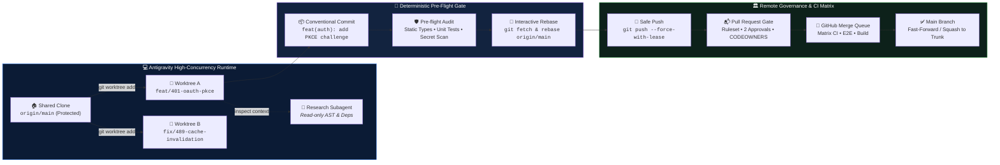
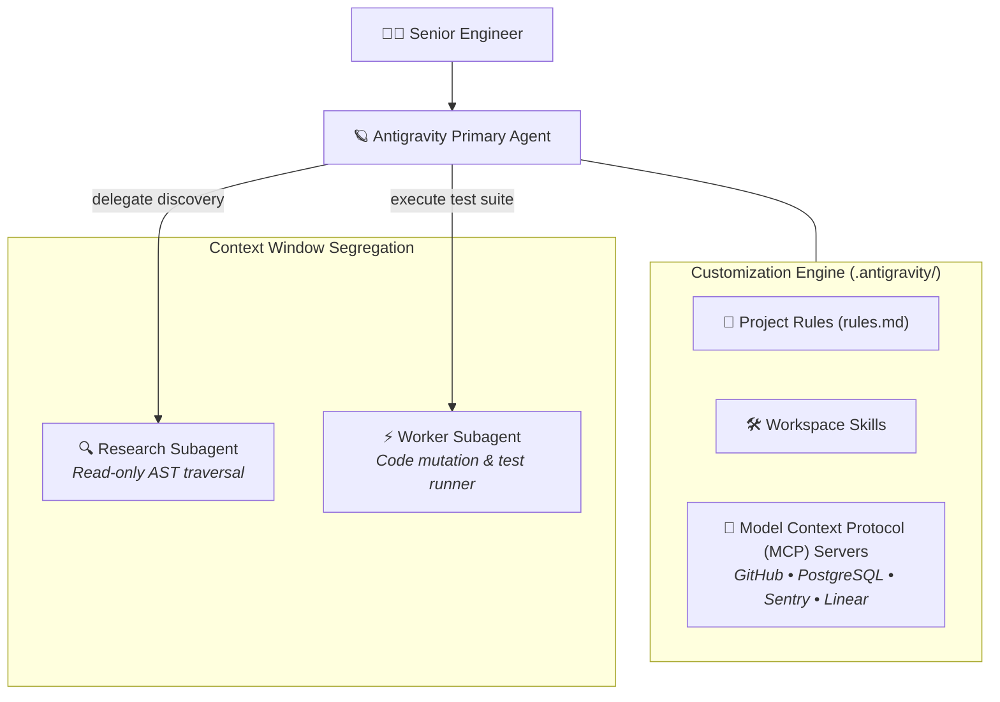
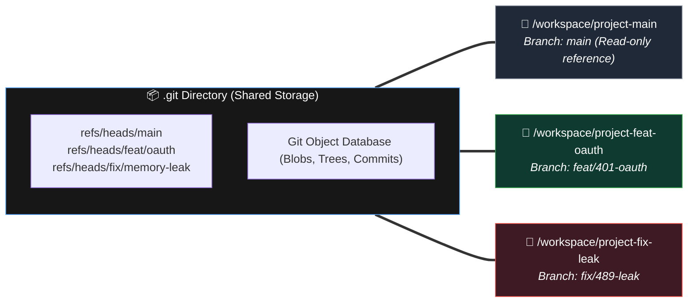
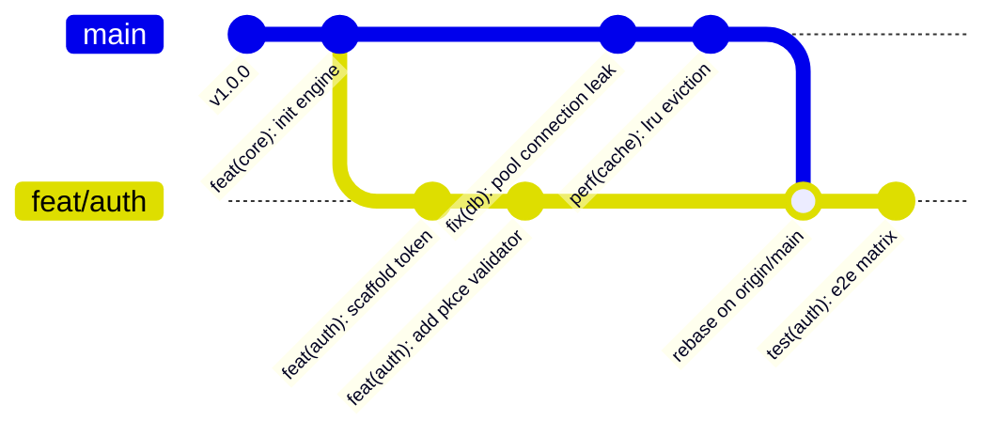
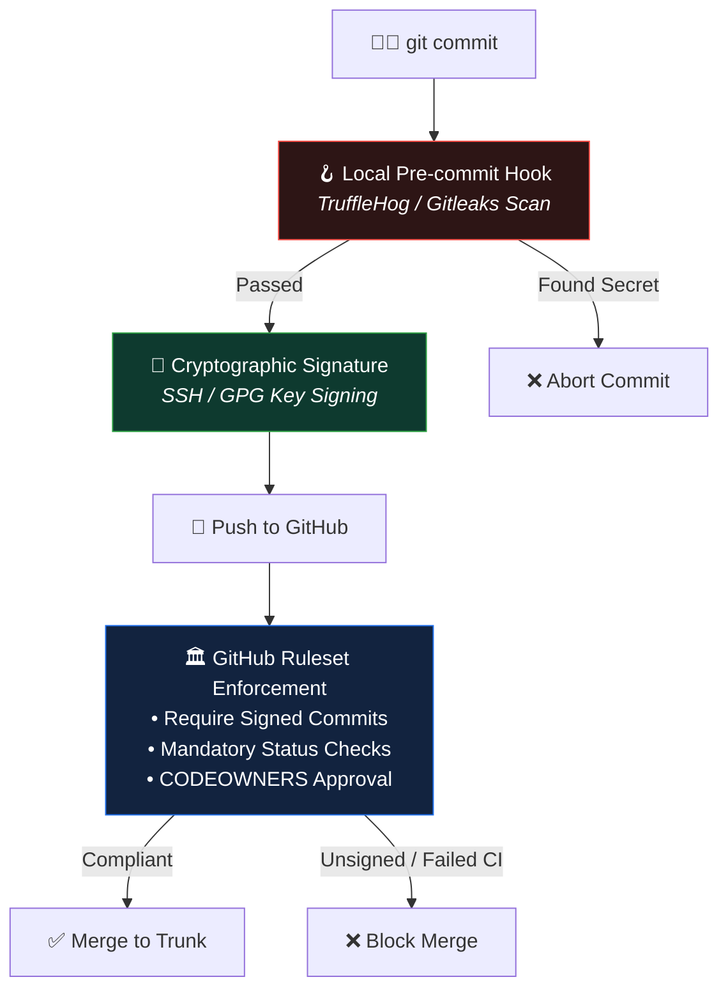

<div align="center">



<br>


**Enterprise Engineering Standard Operating Procedure (SOP) for Scaled Multi-Agent Development, Concurrent Worktrees, Linear Rebase Workflows, and Strict CI/CD Governance with Google Antigravity.**

</div>

---

## ⚡ The Enterprise Agentic Lifecycle



> [!NOTE]
> This playbook is calibrated for senior engineers, engineering managers, and distributed teams operating high-velocity codebases with **Google Antigravity** and **GitHub**. It supersedes basic single-branch guides by introducing concurrency models, AST-aware rebasing, cryptographic signing, and automated PR gates.

---

## 📑 Master Index

| # | Operational Domain | Scope & Core Competency |
|:-:|-------------------|--------------------------|
| 1 | [Architecture & Multi-Agent Model](#1--architecture--multi-agent-development-model) | Antigravity IDE vs `agy` CLI, context containment, read-only subagents, MCP infrastructure |
| 2 | [Concurrency via Git Worktrees](#2--workspace-isolation-concurrent-git-worktrees) | Parallel agent runs, eliminating dirty stashes and lockfile thrashing |
| 3 | [Scaled Branching & Commit Discipline](#3--scaled-branching-strategy--conventional-commits) | Short-Lived Feature Branches (SLFB), Conventional Commits 1.0.0, atomic history |
| 4 | [Antigravity Enterprise Prompts (SOP)](#4--standard-operating-procedures-sops--precision-prompts) | Architecture RFC, TDD scaffolding, pre-flight audits, atomic staging prompts |
| 5 | [Upstream Sync & Linear Rebase](#5--upstream-synchronization--linear-rebase-protocols) | Non-destructive rebasing, avoiding merge commits, `--force-with-lease` safety |
| 6 | [AST-Aware Conflict Reconciliation](#6--ast-aware-merge-conflict-resolution) | Semantic conflict resolution with `zdiff3`, contract validation, regression checks |
| 7 | [CI/CD Gates & PR Automation](#7--continuous-integration-matrix--pr-automation) | Automated PR generators, branch protection rulesets, CODEOWNERS routing |
| 8 | [Security, Cryptography & Secrets](#8--security-hardening-cryptographic-signatures--secrets) | GPG/SSH commit signatures, pre-commit secret scanners, incident triage |
| 9 | [Engineering Lead Governance Checklist](#9--engineering-lead--devops-governance-checklist) | Repository configuration, `.antigravity/rules.md` blueprint, automated checks |
| 10 | [Disaster Recovery & Reflog Runbook](#10--disaster-recovery--git-reflog-runbook) | Salvaging dropped stashes, detangled rebases, and headless state restoration |

---

## 1 · Architecture & Multi-Agent Development Model

Modern agentic engineering shifts developers from manual syntax typists to **system architects and verification leads**. Antigravity provides dual modalities: the full interactive IDE and the headless CLI (`agy`).



### A. Context Segregation & The Subagent Pattern
A frequent failure mode in agentic development is **context window pollution**—dumping large directories, lockfiles, and terminal logs into the primary agent's conversational memory.
* **Primary Agent:** Owns the task trajectory, architectural design decisions, and interaction with you.
* **Research Subagents (`research`):** Invoked to perform deep read-only codebase archaeology, indexing symbol graphs, and validating imports without exhausting the main context window.
* **Worker Subagents:** Run isolated refactor experiments or benchmark suites across isolated workspaces.

### B. Customization Layer (`.antigravity/rules.md`)
Every enterprise repository must track project invariants in version control under `.antigravity/rules.md` to ensure any engineer's Antigravity instance abides by identical code standards.

```markdown
# Team Codebase Invariants
- Runtime: Node.js 22 LTS / Bun 1.2 / Python 3.12 (Strict Types)
- Architecture: Ports and Adapters (Hexagonal); domain logic must never import framework adapters.
- Testing: All mutations must achieve 100% branch coverage on modified business logic.
- Git: Never create merge commits on feature branches. Always rebase against upstream main.
```

### C. Antigravity Slash Command Accelerators
* `/plan`: Enforces hierarchical task decomposition before touching any file.
* `/grill-me`: Triggers an adversarial architectural interview with Antigravity to uncover edge cases and boundary failures prior to implementation.
* `/boost`: Initiates multi-perspective deep reasoning, adversarial code review, and invariant verification.
* `/compact`: Periodically condenses conversation memory during long multi-day feature development.

---

## 2 · Workspace Isolation: Concurrent Git Worktrees

Switching branches inside a single working directory triggers catastrophic side effects during agentic workflows: dangling background watchers, invalid `node_modules` caches, lockfile churn, and accidental uncommitted state mixing.

Enterprise Antigravity teams utilize **Git Worktrees** (`git worktree`) or Antigravity's native `share` workspace mode to run concurrent development threads in true isolation.



### High-Velocity Worktree Playbook

```bash
# 1. Fetch remote changes without touching your current index
git fetch origin --prune

# 2. Spawn a dedicated worktree for a new feature branch based on main
git worktree add -b feat/412-oauth-pkce ../worktrees/project-oauth origin/main

# 3. Open this isolated folder directly in Antigravity
# Antigravity operates on this folder with zero interference to other branches
cd ../worktrees/project-oauth

# 4. Once merged upstream, cleanly decommission the worktree
cd ../project-main
git worktree remove ../worktrees/project-oauth
git branch -d feat/412-oauth-pkce
```

> [!TIP]
> In Antigravity subagent orchestration, the `share` workspace argument automatically harnesses this worktree mechanism, giving subagents independent checkouts while sharing the local object storage without duplicate disk allocation.

---

## 3 · Scaled Branching Strategy & Conventional Commits

We mandate **Trunk-Based Development with Short-Lived Feature Branches (SLFBs)**. Feature branches must live **less than 48 hours** to minimize drift and merge complexity.

### A. Strict Branch Taxonomy

```text
<type>/<issue-tracker-id>-<kebab-case-description>
```

| Type Prefix | Purpose | Example |
|-------------|---------|---------|
| `feat/` | New user-facing or platform functionality | `feat/ENG-2104-stripe-webhooks` |
| `fix/` | Bugfix addressing an existing defect | `fix/ENG-2189-deadlock-connection-pool` |
| `perf/` | Latency reduction or resource optimization | `perf/ENG-2201-redis-pipelining` |
| `refactor/` | Structural code restructuring with zero behavioral change | `refactor/ENG-2210-split-monolithic-router` |
| `test/` | Adding missing integration or regression tests | `test/ENG-2230-e2e-checkout-fixtures` |
| `hotfix/` | Production emergency patch branching off release tags | `hotfix/PROD-0911-sanitize-ssrf-header` |

### B. Conventional Commits 1.0.0 Specification
Every commit must be atomic, bisectable, and adhere strictly to the Conventional Commits format:

```text
<type>(<optional scope>): <subject in imperative mood>

[optional body providing structural rationale and architectural decisions]

[optional footer(s): BREAKING CHANGE, Closes #ISSUE-ID]
```

#### Enterprise Commit Standard:
```text
feat(auth): implement PKCE code verifier and challenge exchange

- Introduce SHA-256 code challenge generation in AuthService
- Persist state parameter in encrypted session storage with 10-minute TTL
- Update OpenAPI schema and add automated integration test suite

Closes ENG-2104
```

> [!IMPORTANT]
> **Atomic Commit Rule:** A commit should encapsulate exactly one logical change. Never bundle refactorings with behavioral changes, or format adjustments with business logic mutations.

---

## 4 · Standard Operating Procedures (SOPs) & Precision Prompts

These precision prompts are calibrated to guide Antigravity through rigorous engineering workflows without hallucinations or accidental regressions.

### SOP 1: Architectural Scaffolding & RFC Alignment

Copy and paste this prompt before writing a single line of production code:

```text
We are implementing [feature/task description] under ticket [ENG-XXXX].
Before modifying or creating any code files:
1. Conduct an architectural impact analysis across the existing codebase.
2. Identify all affected interfaces, database schemas, and shared contracts.
3. Map out potential regression risks, edge cases, and performance implications.
4. Define the test strategy (Unit, Integration, and Mock requirements).
5. Produce a phased, step-by-step implementation plan.
Do not modify any source code until I approve your architectural plan.
```

---

### SOP 2: Test-Driven Atomic Implementation

Once the plan is approved, execute with strict TDD:

```text
Proceed with Phase 1 of our plan:
1. First, scaffold the automated test suite specifying the expected behavior, contracts, and boundary conditions. Run the test to demonstrate it fails for the expected reasons.
2. Implement the minimal production code delta necessary to satisfy the test suite.
3. Verify that all newly added and existing unit tests pass cleanly.
4. Ensure all newly introduced symbols contain strict types, docstrings, and zero compiler warnings.
Show me the test execution results and the exact file diff summary.
```

---

### SOP 3: Pre-Flight Audit & Blast-Radius Verification

Run this before preparing any commit:

```text
We are preparing this feature branch for review. Execute a comprehensive pre-flight audit:
1. Inspect git status and list all modified, added, and untracked files. Confirm no temporary artifacts, .env files, or debug logs exist.
2. Run the project's static type checker, linter, and full test suite.
3. Scan modified files for hardcoded credentials, API keys, or private URLs.
4. Output a structural summary of the changes and confirm all existing business invariants are preserved.
Do not commit or push yet.
```

---

### SOP 4: Atomic Staging & Conventional Commit

Instruct Antigravity to stage and construct semantic commits:

```text
Stage the validated files for ticket [ENG-XXXX].
1. Verify that we are on our feature branch (not main).
2. Generate an atomic Conventional Commit following the format: '<type>(<scope>): <summary>'. Include a detailed body referencing the technical decisions made.
3. Show me the exact commit message and staged diff for confirmation before executing git commit.
Do not push to the remote repository.
```

---

## 5 · Upstream Synchronization & Linear Rebase Protocols

Merge commits (`Merge branch 'main' into feature`) clutter repository history, obscure `git bisect`, and introduce semantic regressions. We enforce a **strictly linear commit graph via rebasing**.



### The Linear Rebase Protocol

When syncing your branch with new commits that landed on `origin/main`:

```bash
# 1. Fetch all latest remote branches and prune deleted references
git fetch origin --prune

# 2. Check out your feature branch
git checkout feat/ENG-2104-pkce

# 3. Rebase your feature commits onto the tip of origin/main
git rebase origin/main

# 4. If fixup commits were made during development, squash them cleanly
git rebase -i --autosquash origin/main
```

### Safe Remote Push Protocol (`--force-with-lease`)
When rebasing modifies commit hashes of already-pushed feature branches, standard `git push` will be rejected. 

> [!CAUTION]
> **NEVER run `git push --force`.** Blind force-pushing overwrites remote work if someone else contributed a commit to your branch or if your local tracking ref is out of date.
> 
> **ALWAYS run `git push --force-with-lease`:**

```bash
git push --force-with-lease origin feat/ENG-2104-pkce
```

`--force-with-lease` checks that the remote branch has not received any new commits since your last fetch. If unexpected commits exist, the push is immediately halted to prevent data loss.

---

## 6 · AST-Aware Merge Conflict Resolution

Textual 3-way merges fail when conflicting code is semantically compatible but syntactically shifted. Antigravity can parse language ASTs to resolve conflicts with zero regression.

### A. Enable Modern 3-Way Diff Engine
Configure Git to use `zdiff3`, which shows the original common ancestor block alongside the conflicting changes:

```bash
git config --global merge.conflictstyle zdiff3
```

### B. Prompting Antigravity for Semantic Conflict Resolution

When a rebase halts on conflict markers (`<<<<<<<`, `|||||||`, `>>>>>>>`):

```text
We have encountered a merge conflict during our rebase onto origin/main.
1. Inspect the conflicting files and locate all conflict markers.
2. Read the common ancestor (|||||||), upstream changes (HEAD/ours), and our feature changes (>>>>>>>).
3. Explain the semantic intent of both modifications in plain English.
4. Synthesize a unified resolution that preserves the upstream bugfixes/interfaces while maintaining our feature's functionality.
5. Re-run our test suite to verify that the reconciled code compiles cleanly and passes all assertions.
Do not run 'git rebase --continue' until I verify your diff.
```

---

## 7 · Continuous Integration Matrix & PR Automation

Pull Requests must contain high-signal technical documentation. Antigravity automates PR drafting by analyzing the exact commit log and structural diff against `origin/main`.

### A. Antigravity PR Generation Prompt

```text
I am ready to open a Pull Request from branch [your-branch] to [main].
Inspect the git diff between origin/main and this branch.
Generate an enterprise-grade Pull Request description adhering to this schema:
- Summary: Executive summary of the change.
- Architectural Decisions: Why this approach was selected over alternatives.
- Changes Introduced: Bulleted list organized by system layer (API, Core, DB, Tests).
- Verification & Test Evidence: Commands run and passing test matrices.
- Breaking Changes / Migrations: Database schema changes or env variables needed.
- Closes: [Issue Ticket ID]
```

### B. Enterprise GitHub Pull Request Template
Ensure `.github/pull_request_template.md` exists in the repository:

```markdown
## 📌 Context & Motivation
<!-- Why is this change required? What problem does it solve? -->
Closes #

## 🏗️ Architectural Changes
<!-- Detail structural changes, design patterns applied, or dependency updates -->

## 🧪 Test Coverage & Verification Matrix
- [ ] Unit Tests: `npm test` / `pytest` passed (100% on new code)
- [ ] Integration Tests: E2E test suite verified
- [ ] Static Analysis: Type-checks and linting pass with 0 errors
- [ ] Secret Scan: Verified 0 keys/tokens in diff

## ⚠️ Breaking Changes / Migration Requirements
<!-- Detail schema migrations, new env variables, or backward incompatible API changes -->
```

---

## 8 · Security Hardening, Cryptographic Signatures & Secrets



### A. Mandatory Cryptographic Commit Signing
Every engineer must sign commits using a hardware token, SSH key, or GPG key to prevent author spoofing:

```bash
# Configure Git to sign all commits with your SSH key
git config --global gpg.format ssh
git config --global user.signingkey ~/.ssh/id_ed25519.pub
git config --global commit.gpgsign true
```

### B. Pre-Commit Secret Scanning
Install `gitleaks` or `trufflehog` within local pre-commit hooks (`.husky/pre-commit`) to block secrets before they hit git storage:

```bash
# Example .husky/pre-commit check
gitleaks protect --staged --verbose
```

### C. Leaked Secret Remediation Protocol
If a secret is inadvertently committed to local git history:

> [!CAUTION]
> Making a new commit that deletes the secret file does **NOT** remove it from Git history.
> 
> 1. Immediately rotate the compromised credential in the production provider.
> 2. Purge the secret from history using `git-filter-repo`:
> ```bash
> pip install git-filter-repo
> git-filter-repo --replace-text <(echo "AKIA_EXACT_SECRET_KEY==>REDACTED")
> ```
> 3. Force-update protected branches with team coordination.

---

## 9 · Engineering Lead & DevOps Governance Checklist

Repository administrators must configure GitHub Rulesets to enforce quality gates at the platform level:

- [ ] **Branch Protection / Ruleset on `main`:**
  - [ ] Require Pull Requests before merging (Direct push to `main` strictly disabled).
  - [ ] Require at least 2 approving reviews before merge.
  - [ ] Dismiss stale pull request approvals when new commits are pushed.
  - [ ] Require review from **Code Owners** (`.github/CODEOWNERS`).
  - [ ] Require status checks to pass before merging (Lint, Typecheck, Test Matrix, SonarQube/CodeQL).
  - [ ] Require branches to be up to date before merging (enforces linear rebase).
  - [ ] Require cryptographically signed commits.
  - [ ] Block force pushes and branch deletions.
- [ ] **Automated Merge Queue:** Enable GitHub Merge Queue for automated parallel integration of validated PRs.
- [ ] **Automated Dependency Updates:** Configure Renovate or Dependabot with automated CI verification.
- [ ] **Antigravity Rule Invariants:** Commit `.antigravity/rules.md` to repository root with project conventions.

---

## 10 · Disaster Recovery & Git Reflog Runbook

Git never deletes committed objects immediately. The `reflog` tracks every pointer shift in your local repository.

### Scenario A: Salvaging an Accidental Hard Reset or Botched Rebase

If a rebase goes awry and you ran `git reset --hard` or lost your commits:

```bash
# 1. View the chronological log of all HEAD pointer movements
git reflog

# Output example:
# 4a2b1c8 HEAD@{0}: reset: moving to HEAD~3
# 9f8e7d6 HEAD@{1}: commit: feat(api): add middleware
# 1c2b3a4 HEAD@{2}: commit: feat(api): add routing

# 2. Restore your branch to the exact state before the mistake
git reset --hard HEAD@{1}
```

---

### Scenario B: Recovering an Accidentally Deleted Local Branch

```bash
# 1. Locate the commit hash that represented the tip of the deleted branch
git reflog | grep "checkout: moving from feat/my-deleted-branch"

# 2. Instantly recreate the branch at that exact commit
git checkout -b feat/my-deleted-branch <commit-hash>
```

---

### Scenario C: Aborting a Rebase in Progress

If rebase conflicts are too tangled and you need to reset to zero without side effects:

```bash
git rebase --abort
```

---

## 📊 Enterprise Command Matrix

| Intent | Git CLI Command | Antigravity Native Capability |
|--------|-----------------|-------------------------------|
| **Parallel Branch Execution** | `git worktree add -b <branch> <path>` | Workspace `share` / `branch` mode |
| **Linear Sync** | `git fetch --prune && git rebase origin/main` | *"Fetch upstream and rebase my branch without merge commits"* |
| **Atomic Commit** | `git add -p && git commit -m "..."` | *"Inspect diff, stage logical hunk, generate Conventional Commit"* |
| **Safe Force Push** | `git push --force-with-lease origin <branch>` | *"Verify remote tracking ref and push with lease"* |
| **Conflict Resolution** | `git diff --check && git status` | *"Parse 3-way AST conflict markers and preserve contracts"* |
| **History Recovery** | `git reflog` | *"Audit reflog history and roll back to pre-incident state"* |

---

<div align="center">

<sub>Google Antigravity Enterprise Engineering Playbook • Production Systems Edition</sub>

</div>
